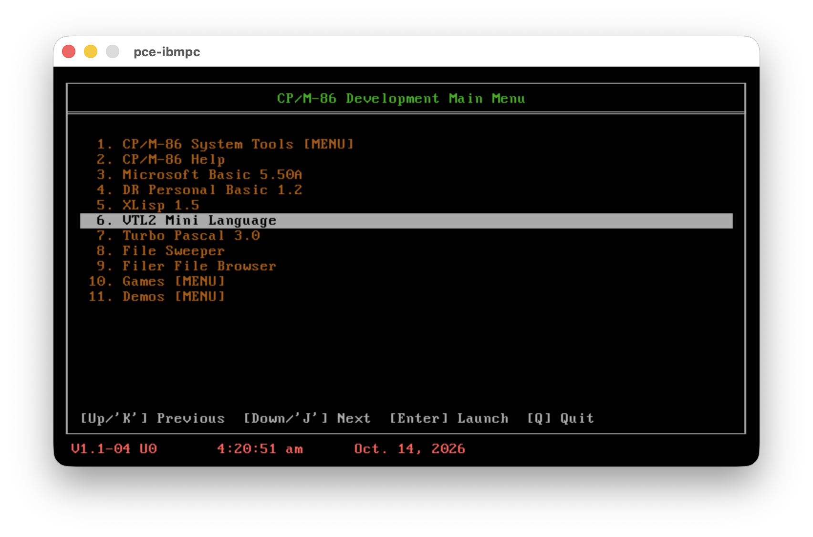

# Menu — CP/M-86 and Concurrent CP/M-86 Application Menu

A lean interactive launch menu with automatic selection of its execution backend.
On CP/M-86 1.1 (BDOS 2.2), the existing CCP `$$$.SUB` stack runs actions and
restarts MENU. On a concurrent system with BDOS >= 3.0, MENU stays resident,
runs actions with `p_cli`, and resumes the same menu and selection. Concurrent
MENU never reads, writes or deletes `$$$.SUB`, and never queues a MENU restart.
Other systems are rejected.

MSUB, the tolerant SUBMIT replacement, and MCLEAN, the legacy stack cleanup
helper, are CP/M-86 1.1 tools only. Both refuse BDOS versions other than 2.2.



## Concurrent execution

The `.dat` format and navigation keys are shared by both backends:

| Entry | Concurrent behaviour |
|---|---|
| `M`, `M!` | Navigate between menus in-process as before. |
| `E`, `EP` | Pass the configured command directly to `p_cli`. |
| `S`, `SP` | Pass `SUBMIT file parameters` to `p_cli`; native SUBMIT must be available. |
| `C`, `CP` | Execute exactly like `E`, `EP`; no chaining. |
| `E!`, `S!`, `C!` | Run the action, reclaim the console, restore context, then exit MENU. |
| `Q` | Exit MENU (unless disabled by `Q!`); an enclosing job can continue. |

MENU saves its user, drive and process priority, applies an `@n` user suffix
when present, launches the action, and reclaims the console before restoring
the saved context. Restoration also runs after launch failure and before a
`!` exit. The wait priority runs ahead of the parent and TMP (at most 197) and is established
before launch so nested SUBMIT can derive its own priority correctly. An
unavailable or unsafe parent priority is reported before launching.

On the concurrent console, MENU disables programmable function-key expansion
with `ESC 6` while displayed and recognizes the XIOS Up/Down codes (`C8h` /
`D0h`). It restores normal expansion with `ESC 7` before launching an action
or exiting, and selects raw keys again when the menu returns. CP/M's existing
VT52 arrow sequences and the J/K keys remain supported.

Only S entries automatically add `SUBMIT`. E and C pass their command unchanged.
Returning actions redraw the resident menu without reloading the `.dat` file.
`EP`, `SP` and `CP` wait for a key before redrawing. A failed launch reports a
footer error and keeps MENU open, including for a `!` entry.

Native SUBMIT owns script parsing, parameters, nesting and script-error
messages. It does not use MENU's tolerant `sub_load` parser, so script syntax
and limits can differ from the CP/M backend. With `S@n`, native SUBMIT resolves
the script from the selected user's context; on CP/M the script is read from
MENU's original user and its expanded commands run in user n. The existing
restriction of `@n` to E and S variants is unchanged.

`p_cli` launch failure is checked; an executed program's exit code is not
interpreted. Console reattachment follows the foreground action's console
lifecycle, not a general wait for arbitrary detached background work.

The stack, restart, MCLEAN, and tolerant S-file rules described below apply to
the **CP/M-86 1.1 backend**. The table above describes their concurrent equivalents.

## Installation

| File | Where |
|------|-------|
| `menu.cmd` | Default drive, any user area |
| `menu.dat` | Same directory as `menu.cmd` |
| `msub.cmd` | Optional: SUBMIT replacement, any drive (see [MSUB](#msub)) |
| `mclean.cmd` | Same place as `menu.cmd`; needed only by entries that run in another user area (see [MCLEAN](#mclean)) |
| `mcheck.cmd` | Optional: checks a `.dat` file (see [MCHECK](#mcheck)) |


## Usage

### MENU

```
MENU [file.dat] [[nPRV]]
```

| Argument | Meaning |
|---|---|
| `file.dat` | Menu file to load (default `menu.dat`), drive prefix allowed. |
| `[n` | Start with entry `n` (1-based) selected. Ignored (entry 1 is selected) if `n` is 0 or beyond the number of entries, e.g. after the `.dat` was edited. |
| `[P` | Show "Press any key to return to the menu" and wait before drawing. |
| `[V` | With `R`: list, for each user area, the records found in `$$$.sub` and whether it was deleted, show the submit flag, and wait for a key. For diagnosis (`MENU [RV]`). |
| `[R` | Reset: delete `$$$.sub` in every user area 0-15 of the current drive before starting, and run as if started from the keyboard. The rest of an enclosing SUBMIT job is lost. Clears a stale `$$$.sub` once `MENU` runs; it cannot help against the one run at cold boot (see [After a reboot](#after-a-reboot)). CP/M-86 1.1 only. |

Options go in one bracket group, CP/M style, and the closing `]` is optional: `[3]`, `[2P]`, `[R]`, `[3PR` are all valid. `[R]` is typed by hand; `menu.cmd` never writes it. `[n` and `[P` are mostly written by `menu.cmd` itself in the re-launch line,
so the menu comes back on the entry that was run and, for `EP`/`SP`/`CP`
entries, after a key press.

### After a reboot

While an entry runs, `$$$.sub` still holds the job that brings the menu back
(`MENU file.dat [n]`). If the machine is reset during the program, that file
survives, and the next cold boot runs it **before anything else**:

- The BDOS sets the CCP submit flag at cold boot when it finds a `$` file in
  the boot drive and user.
- The CCP reads `$$$.sub` before the keyboard. The boot command of `SETUP`
  reaches the CCP as type-ahead (the BIOS copies it into its key buffer), so it
  waits, unread, while the stale `MENU file.dat [n]` runs.
- That `MENU` then reads the waiting boot command as key presses (`B` goes
  back, Enter picks an entry, ...). This is how a menu, then a sub-menu, appear
  with no key pressed, and why the boot command never runs.

Nothing that runs after the boot can prevent this, so `MENU [R]` and
`MCLEAN n [F]` in `AUTOEXEC.SUB` come too late. Fix it in the system: make the
cold start of the CCP ignore a left-over `$$$.sub` (clear the submit flag in
`CCPCLD`), or delete `$$$.sub` from the boot sector's startup path. Until then
leave the menu with `Q` before resetting, or erase `$$$.SUB` from another boot
disk.

### MSUB

```
MSUB [/N] file[.SUB] [parm1 parm2 ...]
```

| Argument | Meaning |
|---|---|
| `/N` | Check only (see below): expand and validate the file, write nothing. |
| `file` | Job file, drive prefix allowed (`B:BACKUP`). `.SUB` is added when no type is given. |
| `parm1` … `parm9` | Replace `$1` … `$9` in the file. Missing parameters expand to nothing. Each is used up to 32 characters. |

With no argument MSUB prints its banner and usage and does nothing. The
`.sub` file rules (`$$`, `^x`, `;` comments, limits) are in
[S / S! files](#s--s-files). Behaviour inside a running job: see [MSUB](#msub).

### MCHECK

```
MCHECK [file.dat]
```

Loads a menu file with the same parser as `MENU` and reports what it
understood, changing nothing (default `menu.dat`). One message per line:

| Prefix | Meaning |
|---|---|
| `INF:` | the title, `Q!`, `M!`, and each entry as `MENU` will see it (type, `P`, `@n`, label, command), then a count |
| `WRN:` | the line is accepted but altered: a title or label over 70 characters (cut), `M!` or `T` without text (ignored) |
| `ERR:` | the line is not understood and `MENU` skips it: unknown line type, missing `\|`, empty label or command, command over 125 characters, line over 255 characters, bad `@n` suffix, a 16th entry |

Each `WRN:` and `ERR:` gives the line number and the line. The exit code is 1
when there is an `ERR:` (or the file cannot be opened), otherwise 0.

### MCLEAN

```
MCLEAN n
```

Written by `MENU` into `$$$.sub` after an entry that ran in user area `n`
(see [Running in another user area](#running-in-another-user-area)). It
deletes an empty `$$$.sub` left in user `n` and does nothing if the file still
holds commands. It is not meant to be typed.

`MCLEAN n [F]` (the closing bracket is optional) deletes the file whatever it holds (use with care: a live job in that
user area loses its remaining commands).


## menu.dat Format

Each line is a **directive**. Lines starting with `;` are comments; blank lines
are ignored. Lines may end with CR LF, LF or CR alone (mixed is fine), and
reading stops at `^Z`. A line longer than 255 characters is skipped. Leading and trailing whitespace around labels and commands is trimmed.
Maximum 15 entries per file.

### Directives

| Directive | Syntax | Description |
|-----------|--------|-------------|
| `T` | `T {title}` | Set the title bar text. Optional; default title used if absent. |
| `CT` | `CT{n}` | Title foreground colour `n` (0–15, default 14). Optional; the number may follow a blank (`CT 11`). |
| `CI` | `CI{n}` | Foreground colour `n` (0–15, default 14) of the entries that are not selected. Optional. |
| `Q!` | `Q!` | Disable the `Q`/Quit key entirely. |
| `E` | `E {label} \| {command}` | Launch command; return to the menu afterwards. |
| `EP` | `EP {label} \| {command}` | As `E`, then wait for a key before the menu redraws (output stays visible). |
| `E!` | `E! {label} \| {command}` | Launch command; exit cleanly — no `MENU` re-launch. |
| `S` | `S {label} \| {file} [{params}]` | Run a SUBMIT file; return to the menu afterwards. |
| `SP` | `SP {label} \| {file} [{params}]` | As `S`, then wait for a key once the whole file has run. |
| `S!` | `S! {label} \| {file} [{params}]` | Run a SUBMIT file; exit cleanly — no `MENU` re-launch. |
| `M` | `M {label} \| {menu.dat}` | Selectable entry: load a sub-menu in-process. |
| `M!` | `M! {menu.dat}` | Directive (not an entry): set the `B`/Back destination for this dat file. |
| `C` | `C {label} \| {command}` | Chain directly to command via `P_CHAIN`; `MENU datfile` queued in `$$$.sub` so CCP returns to menu after. |
| `CP` | `CP {label} \| {command}` | As `C`, then wait for a key before the menu redraws. |
| `C!` | `C! {label} \| {command}` | Chain directly to command via `P_CHAIN`; exits cleanly with no re-launch. |

### `@n` suffix: run in another user area

`E`, `EP`, `E!`, `S`, `SP` and `S!` accept a user area number glued to the
type, with no blank:

```
E@4   WordStar in user 4     | WS
E!@4  Run once in user 4     | BACKUP
SP@12 Nightly job, user 12   | NIGHT
```

| Rule | |
|---|---|
| number | 0 to 15, one or two digits |
| not accepted | `C`, `CP`, `C!`, `M`; a number over 15; a bare `@`; a letter after `@` or after the number (`@4A`). The line is skipped, as for any malformed line, and `MCHECK` reports it. |
| same user | If the menu is already running in user `n`, the suffix has no effect and the entry runs as a normal one. |

See [Running in another user area](#running-in-another-user-area) for what the
suffix does and its limits.

### Field limits

| Field | Max length |
|-------|-----------|
| title (`T`) | 70 chars |
| label | 70 chars |
| command / file+params | 125 chars (longer entries are skipped, never cut) |

### Example

```
; Main menu
T  My CP/M-86 System

E  WordStar 4        | WS
E  SuperCalc 3       | SC
EP Directory         | DIR
SP Run backup        | BACKUP DRIVE A
M  Utilities         | utils.dat
E! Exit to CP/M      | EXIT
```

### Notes

- If an `M`/`M!` target file is missing or empty, the switch is silently ignored
  and the current menu stays active.
- `E`, `S` and `C` entries re-launch `MENU` on the `.dat` they were run from,
  so from a sub-menu (with or without `M!`) the menu comes back on that
  sub-menu, on the entry that was run.
- If an `S` file is missing, empty or invalid, or `$$$.sub` cannot be written,
  the error is shown on the footer line and the menu stays active.

### Nesting (menu inside a SUBMIT job)

`$$$.sub` is used as a stack. When `MENU` is itself a line of a running
SUBMIT job (or of another menu's `S` file), what is left of that job stays in
`$$$.sub` and every launch is pushed **on top** of it:

- `E` / `S` / `C` run the entry, then `MENU` again, as usual.
- `E!` / `S!` / `C!` run the entry, then the rest of the outer job.
- `Q` leaves the menu and the outer job carries on.

`MENU` started from the keyboard starts a fresh `$$$.sub` (any stale one is
removed). Running DR `SUBMIT.CMD` as an entry still replaces the whole file
(that is how `SUBMIT` works); use an `S` entry instead to keep the stack.
`$$$.sub` holds at most 128 commands in total.

### S / S! files

Expanded by `menu.cmd` itself with the DR `SUBMIT` rules, then pushed on the
`$$$.sub` stack:

- `{file}` gets `.SUB` when it has no type; a drive prefix is allowed
  (`B:BACKUP` → `B:BACKUP.SUB`).
- `$1`..`$9` are replaced by the parameters (missing ones expand to nothing;
  each parameter is used up to 32 chars), `$$` gives `$`, `^A`..`^Z` give the
  control character.
- Leading and trailing blanks are removed and blank lines are skipped.
- A line whose first non-blank character is `;` is a comment and is skipped.
  A `;` anywhere else is ordinary text passed to the command:

  ```
      ;    this whole line is ignored
  command ; this is kept, the command gets "; this is kept…"
  ```
- Limits: 125 chars per expanded line, 64 lines per file. Exceeding either is
  reported as an error rather than truncated.
- Lines may end with CR LF, LF or CR alone. Reading stops at the first `^Z`
  (CP/M end of text). `.sub` files made on a
  host and copied with `cpmcp` should end with `^Z` if DR `SUBMIT.CMD` will
  also read them: `SUBMIT` reads the whole last record, including any junk
  after the text. `menu.cmd` does not need the `^Z` itself.

### Drives and user areas

- The re-launch line written to `$$$.sub` is drive-qualified:
  `[D:]MENU D:file.dat [n]` (`[nP]` with a key press). The `MENU` prefix is the drive `menu.cmd` was started
  from (e.g. `B:MENU` typed at `A>`), read from the CCP command buffer; the
  `.dat` file gets the current drive when it has none.
- Programs that change drive or user themselves (BDOS 14/32) are fine: the CCP
  restores its own drive and user on warm boot before reading `$$$.sub`.
- `$$$.sub` is created on the current drive and user, and the CCP reads it from
  the drive and user it is on at that moment. An entry or `.sub` line that is
  a bare drive change (`B:`) or `USER n` therefore ends the `$$$.sub` chain:
  the remaining lines and the `MENU` re-launch are not run. Use a
  drive-prefixed command instead (`E Prog | B:PROG`), which loads from `B:`
  without changing the CCP's current drive. To run an entry in another user
  area use the `@n` suffix instead (next section).
- There is no drive equivalent of `@n`: switching drive in a chain is not
  supported.

### Running in another user area

`E@4 WordStar | WS` runs `WS` with the CCP in user area 4 and then brings the
menu back in the user area it was in. Nothing in the CCP is changed. `MENU`
writes two `$$$.sub` files, one in the current user and one in user 4, and
the CCP moves from one to the other with its own `USER` command, which does
not restart it:

| `$$$.sub` | Records, in the order the CCP runs them |
|---|---|
| user 4 | `WS`, then `USER 0` |
| current user (0 here) | `USER 4`, then `MCLEAN 4`, then `MENU …` (not for `E!`, `S!`) |

For an `S` entry the lines of the `.sub` file replace `WS`. `MCLEAN 4` deletes
the empty `$$$.sub` that the CCP leaves in user 4 once it is back home (see
[submit-flow.md](submit-flow.md), section 10).

- The menu file, `MENU.CMD` and `MCLEAN.CMD` are used from the user area the
  menu runs in; the **entry's program must be in user `n`**, or be a user-0
  file with the SYS attribute. CP/M-86 does not look in user 0 for other files.
- `S` files are read from the current user, as for any `S` entry. Their lines
  run in user `n`.
- A `USER` line or a bare `B:` line inside an `S` file ends the chain, as
  described above; the suffix does not change that.
- If the menu runs in user `n` already, `@n` has no effect.
- A menu started inside a user-`n` stack can hop again (`@m`); each hop goes
  back to the user it started from.
- Both stacks have to fit in 128 records. The check is made before anything is
  written, and a footer error is shown if they do not.


Screen rows use BDOS string output to reduce console-call overhead; selection
changes redraw only the two affected entries.

## Keys

| Key | Action | Notes |
|-----|--------|-------|
| `↑` / `K` | Move selection up | |
| `↓` / `J` | Move selection down | |
| `Enter` | Launch selected entry | |
| `Q` | Quit to CP/M prompt, or back to the SUBMIT job that started `MENU` | Disabled if `Q!` present in `.dat` |
| `B` | Back to parent menu | Only shown after navigating into an `M!` sub-menu |


## MSUB

`msub.cmd` is a drop-in SUBMIT built on the same library as the menu
(`sub_load`), so `.sub` files behave exactly as in `S` entries.

```
B>MSUB

MSUB SUB ORCHESTRATOR VER 1.0

USAGE: MSUB [/N] file[.SUB] [parm1 parm2 ...]
  /N  check only: expand and validate the file, write nothing
```

| | DR `SUBMIT` | `MSUB` |
|---|---|---|
| Expansion | `$1`..`$9`, `$$`, `^A`..`^Z` | same, plus blank lines and `;` comment lines (`;` first non-blank) skipped, blanks trimmed |
| Run from inside a running job | replaces `$$$.sub` (rest of the outer job is lost) | pushes on top: the outer job continues afterwards |
| Errors | `Error On Line n` | `ERROR: <reason> FILE.SUB, line n`. Nothing is written. |
| Limits | 125 chars per line | 125 chars per line, 64 lines, 128 records in `$$$.sub` |

### MSUB /N (check only)

`MSUB /N job p1 p2` runs the same load as a real run and reports, without
writing `$$$.sub` or starting the CCP:

```
B>MSUB /N JOB A B

MSUB SUB ORCHESTRATOR VER 1.0

Checking JOB.SUB

  line 2: DIR A
  line 3: B:
  line 5: TYPE B ^C

WARNING: line 3: drive/user change ends the $$$.SUB chain,
         the commands after it will not run. Use B:PROG instead.
OK: 3 commands = 3 of 128 records. Nothing written.
```

| Check | Result |
|---|---|
| file missing / empty | `ERROR`, nothing listed |
| line over 125 chars, more than 64 lines, bad `^x` | `ERROR` with the source line number |
| expanded lines | listed with their source line (`^C` shown as `^C`), so `$n` substitution can be verified |
| a line that is only `X:` or `USER n` | `WARNING`: it ends the `$$$.sub` chain (see *Drives and user areas*) |
| records: existing `$$$.sub` + new commands | `ERROR` above 128 (the CCP reads one extent). The existing count only applies when MSUB runs inside a job. |
| CCP not recognised | `WARNING`: a real run would write `$$$.sub` but not start it |

`MSUB` can be used inside `.sub` files, in `E` entries and in other `MSUB`
jobs to build nested jobs.


## Limitations

- **Legacy backend: CP/M-86 1.1 only.** The hand-over
  to the CCP requires the known CCP layout (signature check, see
  [submit-flow.md](submit-flow.md)). On an unrecognised CCP the commands are
  written to `$$$.sub` but the CCP is not told to run them.
- **No bare drive or user change in a chain.** `B:` or `USER n` as an entry or
  `.sub` line ends the `$$$.sub` chain (see *Drives and user areas*).
- **User hop (`@n`):** `E`, `EP`, `E!`, `S`, `SP`, `S!` only, user 0 to 15, no
  drive. The program must be in user `n` (or a user-0 SYS file). If the
  `MCLEAN` record does not run, an empty `$$$.sub` stays in user `n` until the
  next hop there. If writing the home stack fails, the user-`n` stack is
  restored to its previous record count. A rollback disk error is reported
  and requires inspecting both stacks before continuing.
- **DR `SUBMIT.CMD` as an entry** replaces the whole `$$$.sub` stack, including
  the `MENU` re-launch and any outer job. Use `S` entries instead.
- **Stack size:** `$$$.sub` holds at most 128 commands in total (the CCP only
  reads the first 16K extent). An `S` file is limited to 64 lines of up to 125
  characters.
- **Menu size:** 15 entries per `.dat`, labels up to 70 characters, commands
  up to 125.
- **No cancel key for a running chain.** This CCP is patched not to stop a
  `$$$.sub` run on a key press. `^C` inside a program does not end submit mode
  either: the BDOS abort path (`CONSTA`) keeps `MDSUBE` or sets it again when
  it finds `$$$.sub` while resetting the disks. A menu with `Q!` therefore has
  no exit by design.
- **emu2:** good for testing the UI and the `$$$.sub` contents. It cannot run
  the CCP loop: BDOS fn 0 ends the emulator instead of returning to a CCP.


## Design documents

| Document | Contents |
|---|---|
| [implementation.md](implementation.md) | Modules, startup, key loop, launch path, CCP access, data formats, limits — mostly diagrams. |
| [submit-flow.md](submit-flow.md) | How `$$$.sub` hands commands to the CCP and loops back to `MENU`, including `MENU` inside a SUBMIT job (section 7) and running in another user area (section 10). |
| [test.md](test.md) | The manual test plan: emu2 checks, regression of every entry type, the user hop, failure cases. |


## Build

Requires the `cpm86-crossdev` toolchain (`aztec42_cc`, `aztec42_link`, etc.).
`mclean.cmd` is assembler, built with `cpm86_asm86` and `cpm86_gencmd` in the
8080 model.

The project also depends on the `util` library from
[cpm86-hacking](https://github.com/tsupplis/cpm86-hacking). The following
files are taken from there and kept in this directory; they are not built here:

| File | Purpose |
|------|---------|
| `util.lib` | Library linked into `menu.cmd`, `msub.cmd`, `mcheck.cmd` and `hello.cmd` |
| `util.h`, `conio.h`, `debug.h`, `dirent.h`, `epoch.h`, `gfx.h`, `sub.h` | Headers used at compile time |

```
make          # builds menu.cmd, msub.cmd, mclean.cmd, mcheck.cmd and hello.cmd
make test-local # host legacy/concurrent execution and screen-output checks
make test-runtime # built CMD version guards and parser checks (emu2)
make dist     # msub.zip: the programs above, sample .dat/.sub files
make clean    # removes all generated files
```

## Companion projects

| Project | Description |
|---------|-------------|
| [cpm86-kernel](https://github.com/tsupplis/cpm86-kernel)     | CP/M-86 1.1 distribution rebuilt from patched and reconstituted sources |
| [ccpm86-kernel](https://github.com/tsupplis/ccpm86-kernel)         | CCP/M-86 3.1 distribution rebuilt from patched and reconstituted sources |
| [cpm86-crossdev](https://github.com/tsupplis/cpm86-crossdev) | Unix CP/M-86 cross development project (compilers, emulation and tools) |
| [cpm86-hacking](https://github.com/tsupplis/cpm86-hacking)   | CP/M-86 miscellaneous tools and PCE emulator helpers |
| [cpm86-cmdtools](https://github.com/tsupplis/cpm86-cmdtools) | CP/M-86 `.cmd` file manipulation tools |
| [cpm86-ports](https://github.com/tsupplis/cpm86-ports)       | CP/M-86 application ports in C and assembler |
| [cpm86-vi](https://github.com/tsupplis/cpm86-vi)             | STevie vi port for CP/M-86 and PC-DOS 1.1 |
| [cpm86-msbasic](https://github.com/tsupplis/cpm86-msbasic)   | A recreaction of msbasic-86 for CP/M-86 and PC-DOS 1.1 from gwbasic sources |
| [cpm86-menu](https://github.com/tsupplis/cpm86-menu)   | A submit replacement and a menu system for submit orchestration for CP/M-86 |
| [cpm86-make](https://github.com/tsupplis/cpm86-make)   | A simple submit based make tool for CP/M-86 |
| [pcdos11-hacking](https://github.com/tsupplis/pcdos11-hacking) | PC-DOS 1.1 distribution, tools and notes |

--

## License

The whole repository is under MIT [License](LICENSE.md) unless specified otherwise in a subdirectory.

