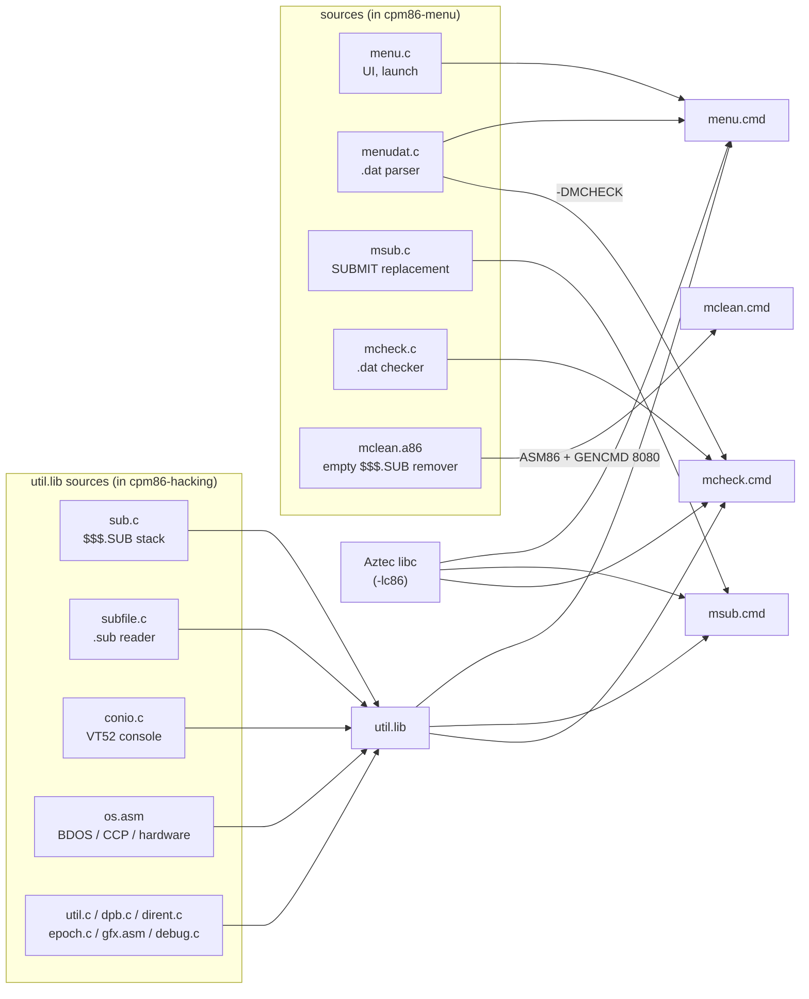
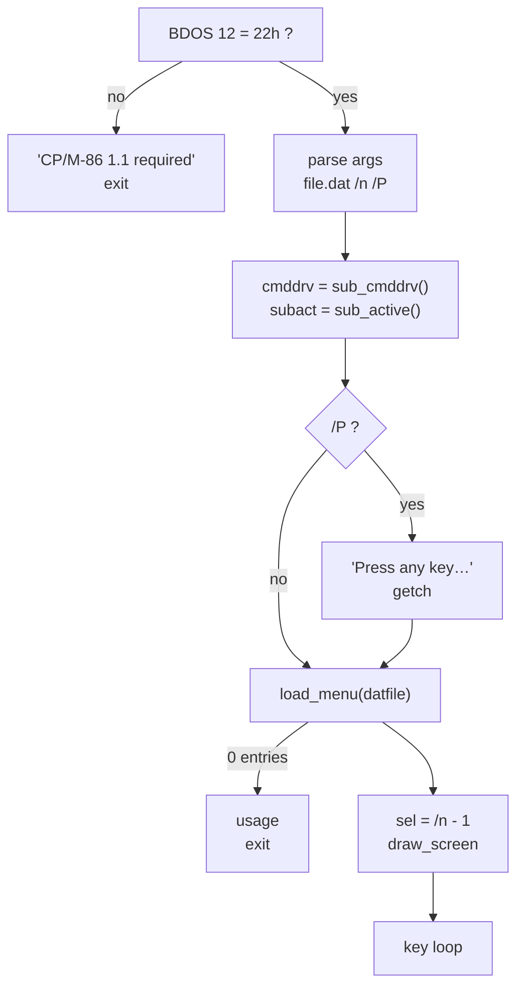
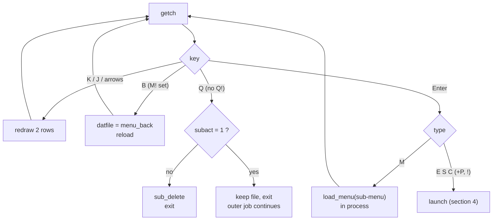
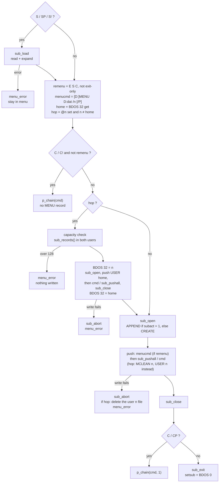
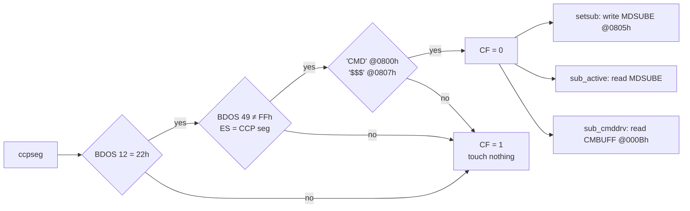

# Implementation overview

How `menu.cmd` is built and how its parts fit. For the CCP hand-over, see
[submit-flow.md](submit-flow.md).

## 1. Modules



`util.lib` is built in `../cpm86-hacking` and copied into this workspace. The headers
(`sub.h`, `conio.h`) are copied alongside it; `menudat.h` is local.
`mcheck.cmd` compiles `menudat.c` a second time with `-DMCHECK`, which adds a
`menu_diag` hook that reports skipped and altered lines. In the normal build
the hook is compiled away. `mclean.cmd` is assembler in the 8080 model (one
segment, a 32-byte stack inside the image).

| File | Key functions used by menu / msub |
|---|---|
| `menu.c` | `main`, `draw_screen`, `draw_entry`, `build_menucmd`, `numrec` (`USER n` / `MCLEAN n` records), `menu_error` |
| `msub.c` | `main`: banner, usage, `/N` check, `sub_load` → push → `sub_exit` |
| `menudat.c` | `load_menu` → `items[]`, `menu_title`, `menu_back`, `menu_quit_disabled`, `menu_has_snr`; uses `sub_readln`; parses the `@n` suffix |
| `mcheck.c` | `main`: `load_menu` with the `menu_diag` hook, prints `INF:` / `WRN:` / `ERR:` |
| `mclean.a86` | `MCLEAN n`: user n, open `$$$.SUB`, delete if 0 records, restore the user |
| `sub.c` | `sub_open` (CREATE / APPEND), `sub_append`, `sub_close`, `sub_records`, `sub_abort`, `sub_delete` |
| `subfile.c` | `sub_load`, `sub_line`, `sub_lineno`, `sub_pushall`, `sub_name`, `sub_errmsg`, `sub_errline`, `sub_readln` |
| `os.asm` | CCP gate: `ccpseg`, `setsub`, `sub_exit`, `p_chain`, `sub_active`, `sub_cmddrv`<br/>OS / hardware: `getcurdrv`, `setcurdrv`, `getccpdrv`, `bdosx`, `delay`, `bioskey`, `pckey`, `xstatline` |
| `conio.c` | `cputs` (BDOS fn 2), `cputc`, `kbhit`, `getch`, `gotoxy`, `clrscr`, `clreos`, `clreol`, `cursor`, `wrapline`, `statline`, `setstatus`, `textcolor`, `scrmode`, `crtreset` |
| `util.c` | `getenv`, `printenv`, `istrcmp` (not used by menu / msub directly) |
| `dirent.c` | `dirent_load`, `dirent_sort`, `dirent_free`, `dirent_is_fat` (not used by menu / msub directly) |

## 2. Startup



## 3. Key loop



## 4. Launch



Exit-only rule: a `.dat` with `M!` and no `S!` entry → `remenu = 0`.

The hop branch (`@n`, E and S types only) writes the user-n stack first so a
failure there leaves nothing in the home user. The records and the CCP side of
it are in [submit-flow.md](submit-flow.md), section 10.

## 5. CCP access (os.asm)



## 6. Data formats

**`$$$.SUB` record** (128 bytes, one per command, last record = top of stack)

| byte 0 | 1 … n | n+1 | n+2 | rest |
|---|---|---|---|---|
| length n (≤ 125) | command, upper case | `00h` | `'$'` | `00h` |

**Re-launch record**

```text
[D:]MENU  D:file.dat  /n  [/P]
 │         │           │    └ EP/SP/CP only: wait for a key first
 │         │           └ entry to select on return
 │         └ current drive added when missing (BDOS 25)
 └ drive MENU was started from (CCP CMBUFF)
```

**`MenuItem`** (`menudat.h`)

| field | size | meaning |
|---|---|---|
| `label` | 71 | shown text |
| `cmd` | 126 | command, `.sub` + params, or `.dat` |
| `type` | int | `MTYPE_E` `ENR` `S` `SNR` `M` `C` `CNR` |
| `pause` | int | 1 for `EP` / `SP` / `CP` |
| `user` | int | `@n` suffix, 0 to 15; `-1` = none |

**Hop records** (`numrec` in `menu.c`)

```text
user n stack (bottom to top):   USER <home>   <cmd | S lines>
home stack (bottom to top):     [outer job]  [MENU ...]  [<drv>:]MCLEAN n  USER n
```

## 7. Limits

| Item | Limit | On overflow |
|---|---|---|
| entries per `.dat` | 15 | ignored |
| label / title | 70 | cut |
| command | 125 | entry skipped |
| `S` file | 64 lines × 125 chars | error, stay in menu |
| `$$$.SUB` | 128 records | write fails → `sub_abort` |
| hop: both stacks | 128 records each | checked before writing, `menu_error` |
| `@n` | 0 to 15 | line skipped (`ERR:` in MCHECK) |
